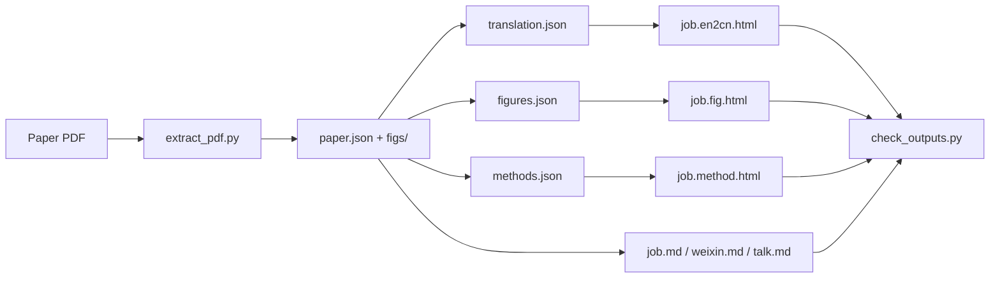

# Sci Paper Reader

[](https://github.com/CropCoder/sci-paper-reader/actions/workflows/ci.yml)
[](LICENSE)
[](https://www.python.org/)
[](CONTRIBUTING.md)

**Turn one research-paper PDF into a complete, readable and shareable Chinese interpretation kit.**

Sci Paper Reader is a portable skill for DeepSeek Harness (and other agent runtimes that support
`SKILL.md`). Given a paper PDF, it produces a bilingual paragraph-by-paragraph reader, a figure
gallery, a methods explainer, a WeChat-style science article, and a 3–5 minute group-meeting talk —
all generated from the same source of truth and checked before delivery.

> 一篇论文 PDF → 6 份可直接阅读、汇报和发布的中文材料。

---

## What it produces

| Output | What it is |
|---|---|
| `job.md` | Key short title, one-sentence takeaway, keywords, three highlights, paper metadata |
| `job.en2cn.html` | Left English / right Chinese paragraph-by-paragraph reader with TOC, search, bookmarks, progress, dark mode, print |
| `job.fig.html` | Top figure navigation + figure-by-figure gallery: overview logic, legend translation, interpretation, meaning, conclusion, caveats |
| `job.method.html` | Materials & methods broken down in paper order: principle, how it was used, parameters, interpretation, original citation |
| `job.weixin.md` | WeChat-style science article with a complete story line and embedded figures |
| `job.talk.md` | 3–5 minute group-meeting script with publication info, team, background, question, results, novelty and takeaways |


## How it works



## Features

- **Faithful, paragraph-aligned translation.** Every English paragraph keeps its own ID and its own
  Chinese paragraph; technical terms keep the English on first use; numbers and units are preserved.
- **Figure-aware extraction.** The PDF extractor handles single- and two-column layouts, vector and
  raster figures, captions above or below the figure, and writes best-effort crops with confidence flags.
- **Manual re-crop escape hatch.** `crop_figure.py` re-renders any figure from PDF coordinates and can
  update `paper.json` in place.
- **Unified visual language.** Warm paper, ink, terracotta accent, serif typography (Times New Roman
  for English), fixed 1120 px reading width, and the same header/sidebar/hero system across all pages.
- **Top navigation.** Switch between the reader, figure gallery and methods pages; jump to any section,
  Figure or method from a module menu.
- **Local-first.** HTML pages are self-contained, work offline, and do not require a CDN.
- **Quality gates.** A validation script checks required files, images, translation coverage,
  figure interpretations, citation links, WeChat paragraph length and talk length.

## Quick start

```bash
git clone https://github.com/CropCoder/sci-paper-reader.git
cd sci-paper-reader

python3 -m pip install --user -r requirements.txt

# 1. Extract text, figures and editable JSON templates from a PDF
python3 scripts/extract_pdf.py paper.pdf -o paper_解读

# 2. Fill the three JSON templates (see references/schemas.md)
cp paper_解读/translation.template.json paper_解读/translation.json
cp paper_解读/figures.template.json   paper_解读/figures.json
cp paper_解读/methods.template.json   paper_解读/methods.json

# 3. Write job.md / job.weixin.md / job.talk.md, then build the pages
python3 scripts/build_en2cn.py --paper paper_解读/paper.json \
  --translation paper_解读/translation.json --out paper_解读/job.en2cn.html
python3 scripts/build_fig.py --paper paper_解读/paper.json \
  --figures paper_解读/figures.json --out paper_解读/job.fig.html
python3 scripts/build_method.py --paper paper_解读/paper.json \
  --methods paper_解读/methods.json --out paper_解读/job.method.html

# 4. Validate
python3 scripts/check_outputs.py paper_解读
```

Open `paper_解读/job.en2cn.html` in a browser. No server is required.

## Install as an agent skill

Copy the directory into a skill root scanned by your agent runtime. For DeepSeek Harness:

```bash
git clone https://github.com/CropCoder/sci-paper-reader.git ~/.agents/skills/sci-paper-reader
```

Or keep it project-scoped:

```bash
git clone https://github.com/CropCoder/sci-paper-reader.git <project>/.agents/skills/sci-paper-reader
```

The agent-facing contract lives in [`SKILL.md`](SKILL.md). It tells the agent when to use the skill,
which files to produce, how to translate, how to read figures, how to trace method citations, and how
to run the QA script.

## Output layout

```text
paper_解读/
├── job.md
├── job.en2cn.html
├── job.fig.html
├── job.method.html
├── job.weixin.md
├── job.talk.md
├── paper.json              # structured extraction (sections, paragraphs, figures, captions)
├── translation.json        # paragraph-aligned Chinese translation
├── figures.json            # per-figure interpretations
├── methods.json            # method cards + citations
└── figs/
    ├── fig1.png
    ├── fig2.png
    └── ...
```

## Repository structure

```text
.
├── SKILL.md                 # Agent workflow and quality rules
├── README.md
├── LICENSE
├── CONTRIBUTING.md
├── CODE_OF_CONDUCT.md
├── SECURITY.md
├── CHANGELOG.md
├── CITATION.cff
├── requirements.txt
├── references/
│   ├── schemas.md           # JSON contracts and examples
│   ├── translation.md       # translation rules
│   ├── figures.md           # how to read and describe figures
│   ├── methods.md           # method tracing and citation verification
│   ├── wechat.md            # WeChat article structure and style
│   ├── talk.md              # 3–5 minute talk structure
│   └── qa.md                # delivery checklist
├── scripts/
│   ├── extract_pdf.py       # PDF → paper.json + figures + templates
│   ├── build_en2cn.py       # translation.json → job.en2cn.html
│   ├── build_fig.py         # figures.json → job.fig.html
│   ├── build_method.py      # methods.json → job.method.html
│   ├── check_outputs.py     # bundle validation
│   ├── crop_figure.py       # manual figure re-crop
│   └── build_common.py      # shared builder helpers
├── templates/
│   ├── en2cn.html / en2cn.js
│   ├── fig.html / fig.js
│   ├── method.html / method.js
│   ├── site-nav.js          # shared page/module navigation
│   └── theme.css            # shared visual system
└── tests/
    ├── fixtures/
    └── test_builders.py
```

## Requirements

- Python 3.10+
- [PyMuPDF](https://pypi.org/project/PyMuPDF/) for PDF extraction and rendering
- Node.js only if you want to run `node --check` on the browser scripts (not required to generate pages)

The generated HTML has no runtime dependency: system fonts, inline CSS and inline data.

## Design notes

- **One source of truth.** The agent edits JSON (`translation.json`, `figures.json`, `methods.json`),
  never the generated HTML. Rebuilding is deterministic.
- **Separate extraction from interpretation.** `paper.json` is the mechanical layer; interpretation is
  explicit and reviewable.
- **No fabrication.** Numbers, citations, authors and journal metadata must come from the PDF or a
  verified DOI page. The QA script flags missing images, uncovered paragraphs and unsourced methods.
- **Readable pages.** The reader uses `Times New Roman` / Songti for body text, a 1120 px fixed
  reading column, bookmarks in `localStorage`, and a shared top navigation across the three pages.

## Testing

```bash
python3 -m unittest discover -s tests -v
python3 -m compileall -q scripts tests
node --check templates/en2cn.js
node --check templates/fig.js
node --check templates/method.js
node --check templates/site-nav.js
```

CI runs the same checks on every push and pull request.

## Contributing

Issues and pull requests are welcome. Please read [`CONTRIBUTING.md`](CONTRIBUTING.md) before opening
a PR, and use the issue templates for bug reports and feature requests.

## License

Released under the [MIT License](LICENSE).

## Citation

If you use this skill in academic work, see [`CITATION.cff`](CITATION.cff).
